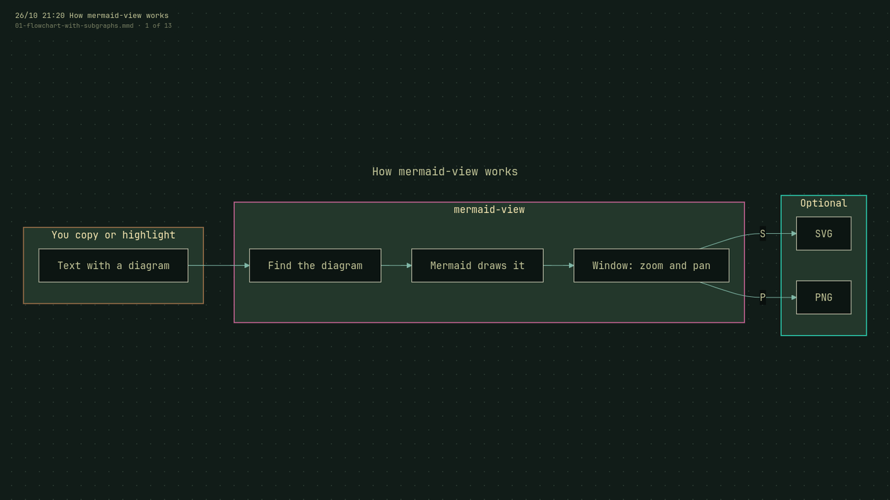
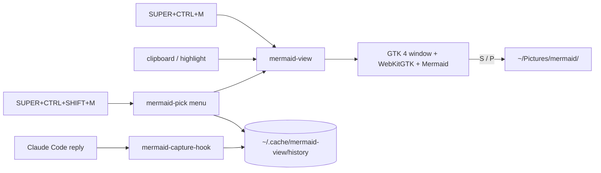

# mermaid-view

A minimal, view-only window for [Mermaid](https://mermaid.js.org/) diagrams
on Linux (Wayland). Copy or highlight some Mermaid text, press a key, and the
diagram appears. You can zoom, pan and save it. There is no editor, no
toolbar and no settings.

It was built for reading the diagrams that AI assistants such as
[Claude Code](https://claude.com/claude-code) write in the terminal, and it
fits in with [Omarchy](https://omarchy.org/) (Hyprland). An optional Claude
Code hook saves every diagram Claude writes, so you can pick one from a menu
later.



## Quick reference

| Do this | To get |
|---|---|
| Copy (or just highlight) diagram text, then **SUPER+CTRL+M** | The diagram, in a floating window |
| **SUPER+CTRL+SHIFT+M** | A menu of diagrams Claude Code wrote recently |
| `mermaid-view FILE` | View a `.mmd` file, or a Markdown file's first ` ```mermaid ` block |
| Drag / scroll wheel | Pan / zoom around the pointer |
| `+` `-` | Zoom in / out |
| `0` / `1` | Fit to window (how it opens) / actual size |
| `S` / `P` | Save SVG / PNG (2×) to `~/Pictures/mermaid/` |
| `←` `→` | Previous / next diagram file in the same folder |
| `Q` or `Esc` | Close |

The key bindings are suggestions; you add them yourself (see
[Install](#install)).

## What it does with what you copy

It looks at the clipboard first and, if that has no Mermaid in it, at the
last text you highlighted (the Wayland "primary selection").

You don't have to copy precisely:

| Copied text | Result |
|---|---|
| Contains a ` ```mermaid ` block | Only that block is used, so you can copy a whole reply |
| Prose, then a diagram | Lines before the first diagram header (`flowchart LR`, `sequenceDiagram`, `pie title …`) are skipped |
| A diagram, then prose | Cut at the blank line before the prose; the label says how many lines were ignored |
| No Mermaid | A desktop notification, no window |
| A diagram with a mistake | Mermaid's error message and your text |

The top-left label shows the diagram's title and where it came from
(`From clipboard · 21:13`), or for a file its name and position in the
folder (`3 of 13`).

## Requirements

| | Arch / Omarchy package | Notes |
|---|---|---|
| Wayland session | | Reads the clipboard with `wl-paste` |
| Python 3.11+ | `python` | |
| PyGObject | `python-gobject` | In Omarchy's base install |
| GTK 4 + WebKitGTK 6.0 | `webkitgtk-6.0` | **Not** in stock Omarchy |
| wl-clipboard | `wl-clipboard` | In Omarchy's base install |
| A menu, for the picker | (Omarchy's own) | Falls back to walker, fuzzel, rofi or wofi |

Mermaid itself is included (`vendor/`), so nothing is downloaded when you
view a diagram.

Tested on Omarchy 4.0.6 (Hyprland 0.56) with all 22 stock themes, on one
and two monitors at scale 1. HiDPI scaling is untested.

## Install

```bash
git clone https://github.com/arffe/mermaid-view.git
cd mermaid-view
./install.sh
```

Clone it wherever you keep code. `install.sh` checks the dependencies, links
`mermaid-view` and `mermaid-pick` into `~/.local/bin`, and prints the lines
below for you to paste. It does not edit any config files itself.

The links point at the cloned folder, so keep it in place. If you move it,
run `./install.sh` again from the new location and update the hook path if
you added the hook.

### Omarchy 4 (Hyprland Lua config)

`~/.config/hypr/bindings.lua`:

```lua
o.bind("SUPER + CTRL + M", "Mermaid viewer (clipboard)", o.launch("mermaid-view"))
o.bind("SUPER + CTRL + SHIFT + M", "Mermaid viewer (recent from Claude)", o.launch("mermaid-pick"))
```

`~/.config/hypr/hyprland.lua`, so the window floats, centred, at 80% of the
screen and fully opaque:

```lua
o.window("^mermaid-view$", {
  float = true,
  center = true,
  size = { "(monitor_w*0.8)", "(monitor_h*0.8)" },
  tag = "-default-opacity",
  opacity = "1 1",
})
```

Then run `hyprctl reload && hyprctl configerrors`.

### Other Hyprland or Wayland setups

Bind the two commands with your compositor's usual syntax, for example in a
classic `hyprland.conf`:

```ini
bind = SUPER CTRL, M, exec, mermaid-view
bind = SUPER CTRL SHIFT, M, exec, mermaid-pick
```

and add a window rule making the app ID `mermaid-view` float. Window-rule
syntax has changed between Hyprland versions, so check the wiki for yours.
Without Omarchy the viewer uses a plain dark theme.

### Claude Code auto-capture (optional)

Add a `Stop` hook to `~/.claude/settings.json`, next to the other top-level
settings. `install.sh` prints this with your real path filled in:

```json
"hooks": {
  "Stop": [{ "hooks": [{
    "type": "command",
    "command": "/path/to/mermaid-view/mermaid-capture-hook",
    "async": true,
    "timeout": 10
  }] }]
},
```

Watch the commas, because a mistake here can stop Claude Code reading the
whole settings file:

| Where you paste it | Comma to use |
|---|---|
| With more settings after it | Keep the one after the closing `}` |
| As the last setting | Remove that one, and add one to the end of the line before |

If you already have `"hooks"`, add only the `"Stop"` part inside it. If you
already have a `"Stop"` hook too, add just this `{ "hooks": [ … ] }` entry to
its list, with a comma between the entries.

Then check the file:

```bash
python3 -m json.tool ~/.claude/settings.json >/dev/null
```

No output means it's fine. Otherwise it names the line to fix.

After each reply, the hook saves any ` ```mermaid ` blocks to
`~/.cache/mermaid-view/history/` (newest 50 kept, duplicates skipped).
It runs in the background and always exits successfully, so it can't slow
down or interrupt Claude. SUPER+CTRL+SHIFT+M lists what it has saved.

### Try it

From the cloned `mermaid-view` folder:

```bash
mermaid-view examples/01-flowchart-with-subgraphs.mmd
```

then press `→` to step through one example of each diagram type.

## How it works



| File | What it does |
|---|---|
| `mermaid-view` | Python + GTK 4. Reads the clipboard, highlight or file; finds where diagrams could start; reads the Omarchy theme; opens the window; saves files |
| `viewer.html` | The page inside the window. Asks Mermaid which candidate parses, draws it, and handles zoom, pan, keys and theme colours |
| `vendor/mermaid.min.js` | Mermaid 11.12.0, pinned (see `vendor/README.md`) |
| `mermaid-capture-hook` | The optional Claude Code hook |
| `mermaid-pick` | Bash: lists captured diagrams in a menu, opens the chosen one |

The drawing is done by the official Mermaid library, so diagrams look the
same as on GitHub or in Obsidian. Zoom resizes the SVG rather than scaling a
bitmap, so text stays sharp. PNG export uses a WebKit snapshot, because
Mermaid's HTML labels can stop a browser canvas from exporting.

**Theme.** Each window reads the current Omarchy theme
(`~/.local/state/omarchy/current/theme/colors.toml`, or
`~/.config/omarchy/current/…` on older versions) and font, and maps them
onto Mermaid's `base` theme. Light themes are detected by their `mode`.
Without a theme file it falls back to Mermaid's dark theme.

**Two workarounds** for Mermaid quirks live in `viewer.html`: subgraph titles
are kept on one line (Mermaid wraps them at 200px but leaves room for only
one line), and XY charts get a full colour set (setting only the palette
turns the background white). Re-check both after updating Mermaid.

## Updating Mermaid

```bash
tools/update-mermaid 11.13.0
```

This downloads the release from npm (via jsDelivr), checks it is the browser
build, and records the version and SHA-256 in `vendor/README.md`. Then open
the examples, especially the subgraph flowchart and the XY chart, and update
the bundled-library table in `THIRD_PARTY_NOTICES.md` if it changed.

## Uninstall

From the cloned `mermaid-view` folder:

```bash
./install.sh --uninstall
```

removes the two links. Remove the key bindings, window rule and hook by
hand. Saved files stay in `~/.cache/mermaid-view/` and `~/Pictures/mermaid/`.

## Limitations

- Wayland only (`wl-paste`). On X11 the file mode still works.
- View only, by design: no editing, no live reload, no export options.
- One diagram per window. A Markdown file with several blocks shows the
  first; use separate `.mmd` files to step through them.
- Prose after a diagram is only cut off at a blank line, so a sentence
  directly under the last diagram line shows as an error.

## Licence

MIT, see [`LICENSE`](LICENSE). Mermaid and the libraries it bundles are
under their own licences, listed in
[`THIRD_PARTY_NOTICES.md`](THIRD_PARTY_NOTICES.md).
